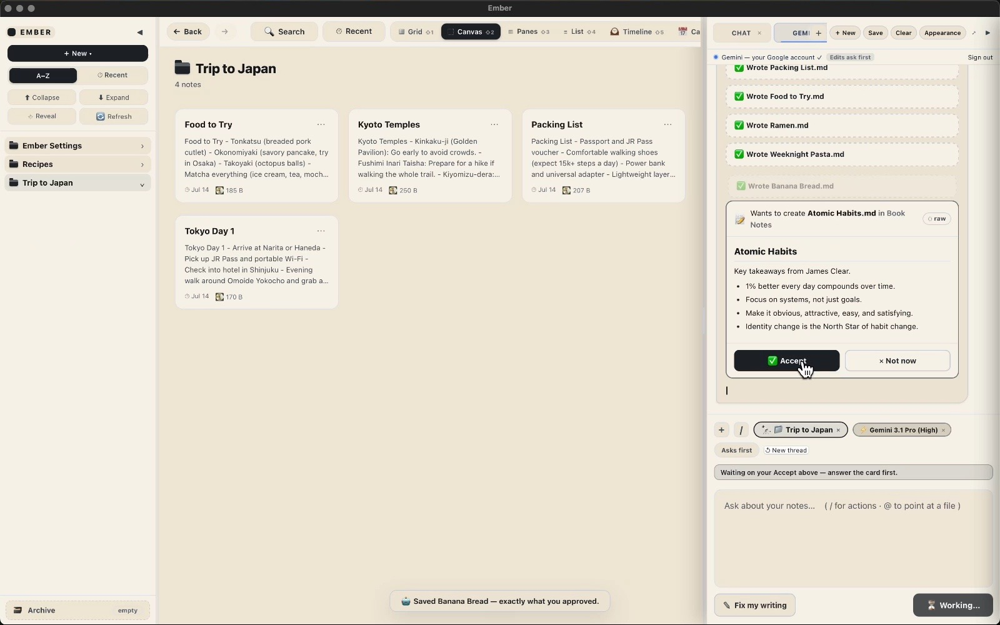
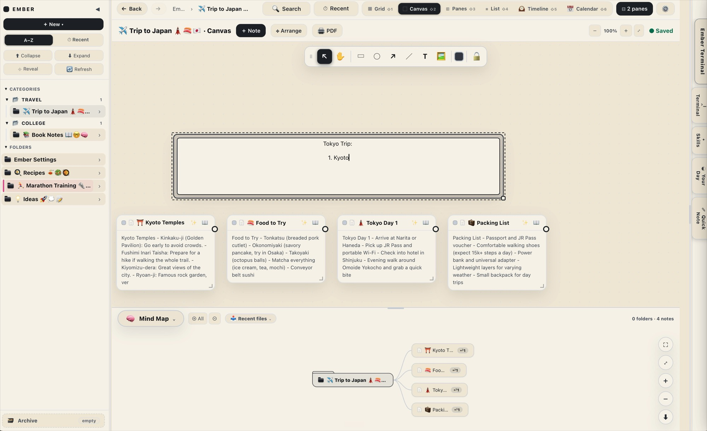
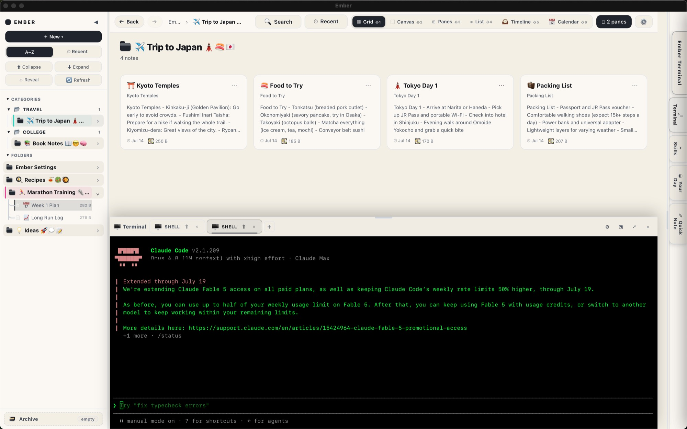
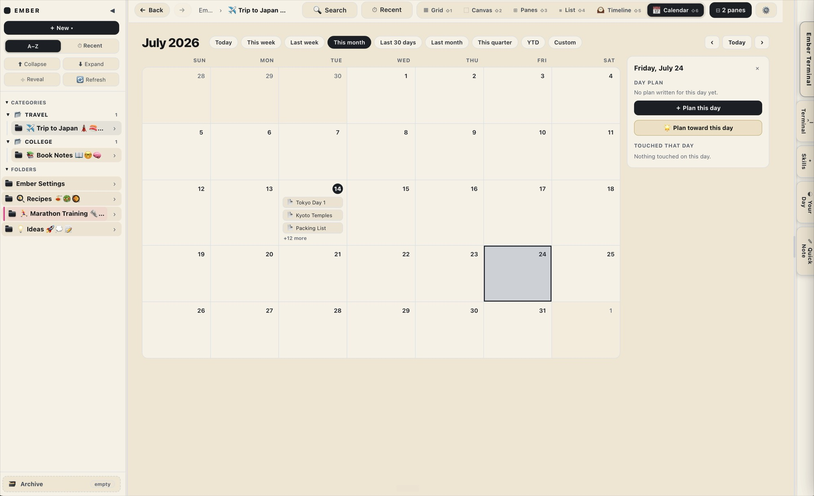

  

<h1 align="center">Ember</h1>

<b>A private AI notebook for your Mac. I designed and built it.</b>

  <a href="https://github.com/embernotebook/ember"><b>Get the app</b></a>
  &nbsp;&middot;&nbsp;
  <a href="https://embernotebook.com"><b>Website</b></a>

  

## What it is

Ember is a Mac app that turns an AI assistant into a notebook that actually remembers you. Everything you tell it becomes a plain Markdown file on your own Mac. You teach it something once and it keeps it. You bring any AI you want, from Claude to a local model that runs with the Wi-Fi off. Your notes never leave your machine unless you choose.

## Why I built it

I got tired of a chatbot that forgot me every time. Every new conversation started from zero, so I began having it write everything down into plain files on my Mac. The folder grew until my notes knew me better than the chatbot did, and I stopped opening the chatbot at all. Ember is that idea turned into a real app anyone can use.

## What I did

- Designed the whole product: the notebook, the canvas and mind map, the built-in terminal, the calendar that plans toward a date, and the sign-in flow.
- Made privacy the default: notes stay as plain files you own, and you can lock a folder so the AI cannot read it.
- Built it to run on any AI, or fully offline on a local model.
- Took it all the way to a signed and notarized Mac app that installs with no warnings.

## See it

- **Product and download:** [github.com/embernotebook/ember](https://github.com/embernotebook/ember)
- **Website:** [embernotebook.com](https://embernotebook.com)

## A look inside

    
    
  

## Built by

**Muhammad Nabeel**
[GitHub](https://github.com/MrNabeel) &middot; [LinkedIn](https://www.linkedin.com/in/mrnabeel1)

Built with Claude.
